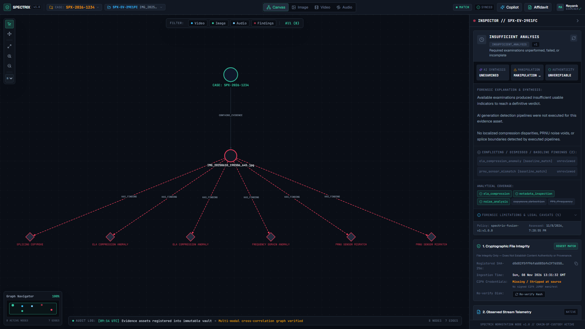
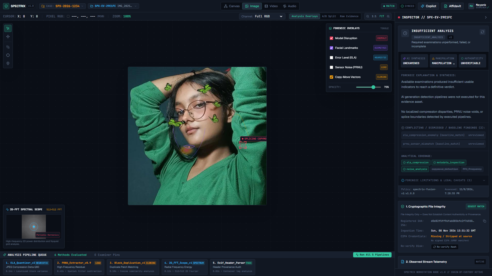
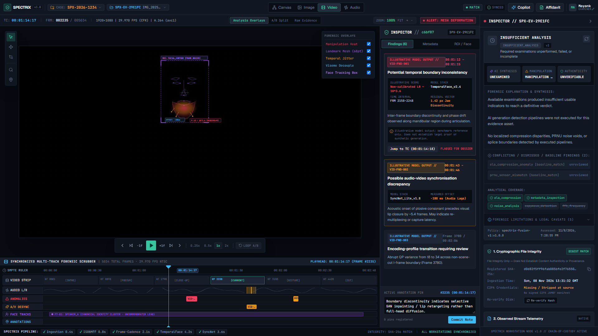
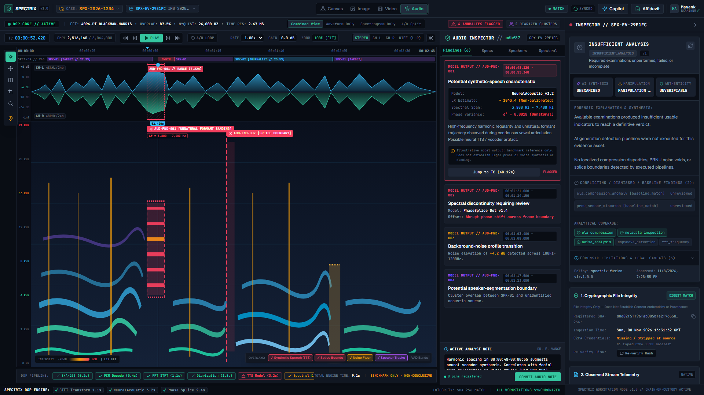
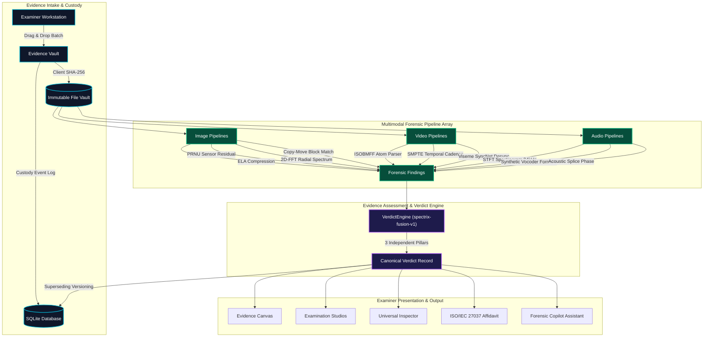

<div align="center">

# SPECTRIX // Multimodal Digital Forensics & Evidence Intelligence Platform

[](.github/workflows/ci.yml)
[](apps/api/tests)
[](LICENSE)
[](apps/api)
[](apps/web)
[](#forensic-integrity--admissibility-principles)

**An enterprise-grade, local-first digital forensics workstation suite engineered for neural deepfake detection, cross-modal signal tampering analysis, cryptographic chain-of-custody tracking, and court-admissible affidavit generation.**

[Key Workspaces](#workspaces-gallery) • [Forensic Verdict Engine](#final-forensic-verdict--assessment-engine) • [Architecture](#forensic-architecture) • [Getting Started](#getting-started) • [Security & Admissibility](#forensic-integrity--admissibility-principles)

</div>

---

## System Overview

SPECTRIX provides law enforcement examiners, digital forensics incident response (DFIR) specialists, intelligence analysts, and media verification desks with a defensible, explainable media verification workstation.

Unlike black-box AI detectors that output uncalibrated percentages, SPECTRIX implements **deterministic signal processing**, **calibrated forensic neural estimators**, and a **transparent fusion policy engine** (`spectrix-fusion-v1:1.0.0`). Every observation is anchored to immutable cryptographic SHA-256 digests and explicit method limitations.

---

## Workspaces Gallery

*(All visuals captured directly from the live SPECTRIX workstation build)*

### 1. Evidence Intelligence Canvas
Graph-based investigative environment correlating cross-modal evidence items, C2PA provenance hops, forensic finding clusters, and facial cosine similarity links powered by a responsive Cytoscape.js force-directed topology.



### 2. Image Examination Studio
Spatial and spectral pixel forensics featuring Error Level Analysis (ELA) with dynamic quality scaling, PRNU sensor noise residual matching, 2D-FFT radial lattice magnitude spectrum, copy-move clone-block matching, 5x pixel loupe, channel isolation, and the multi-pillar Final Forensic Assessment panel.



### 3. Video Examination Studio
Frame-accurate SMPTE playback (29.97 fps) with J/K/L keyboard transport controls, multi-track timeline, 68-point facial landmark mesh with mandibular shearing tracking, SyncNet audio-visual viseme desynchronization, and ISOBMFF container atom parser.



### 4. Audio Examination Studio
Synchronous dual-channel vector waveforms (CH-L/CH-R), high-resolution STFT spectrograms (0–24 kHz), acoustic splice phase-angle discontinuity detection, synthetic vocoder harmonic striation analysis, and ambient noise floor elevation checks.



### 5. Evidence Vault & Batch Intake
Multi-file drag-and-drop batch ingestion with client-side SHA-256 precomputation, case isolation boundaries, metadata extraction, and automatic modality routing to specialized studios.


### 6. Legal Affidavit & Telemetry Dossier Export
Court-admissible evidentiary export compliant with ISO/IEC 27037:2012 standards. Emits structured CommonMark affidavits and raw forensic telemetry JSON containing hardware identifiers, UTC custody logs, and examiner credentials.


---

## Final Forensic Verdict & Assessment Engine

SPECTRIX departs from naive score averaging by implementing a dedicated **Verdict & Fusion Engine** (`spectrix-fusion-v1:1.0.0`).

### 1. The Five Canonical Forensic Verdicts

| Verdict Category | Criteria & Legal Semantics |
| :--- | :--- |
| `AUTHENTICITY_SUPPORTED` | No significant manipulation indicators detected by completed examinations. Available results support authenticity *strictly within the technical boundaries of executed pipelines*. |
| `LIKELY_MANIPULATED` | Multiple reliable indicators or strong validated evidence establish post-capture tampering (splicing, copy-move, compression anomalies, or container splice). |
| `LIKELY_AI_GENERATED` | Validated synthetic generative models or frequency-domain lattice artifacts indicate synthetic origin (diffusion, GAN, neural vocoder, face re-enactment). |
| `SUSPICIOUS_INCONCLUSIVE` | Contradictory findings or unresolved anomalies exist, but evidence cannot establish a legally defensible conclusion. |
| `INSUFFICIENT_ANALYSIS` | Required baseline pipelines have not executed, failed, or produced uncalibrated data. Never defaults to a false negative. |

### 2. The Three Independent Assessment Pillars

SPECTRIX assesses evidence along three orthogonal dimensions:
1. **AI-Generation Pillar**: Evaluates synthetic generative models independently of post-capture tampering.
2. **Manipulation Pillar**: Evaluates localized splicing, copy-move, and temporal discontinuities independently of synthetic generation.
3. **Authenticity Pillar**: Evaluates positive evidence of organic camera capture (PRNU sensor fingerprint, consistent EXIF/container metadata, natural noise distribution).

### 3. Assessment Immutability & History Tracking
Assessments are cryptographically versioned. If new findings are recorded or examiner annotations are applied, prior assessments are marked `superseded` and archived. Forensic history is never deleted or overwritten.

---

## Forensic Architecture



---

## Forensic Pipelines Matrix

| Modality | Pipeline Identifier | Method & Model Reference | Target Artifact | Calibrated Limitations |
| :--- | :--- | :--- | :--- | :--- |
| **Image** | `ela_compression` | Error Level Analysis (`v1.2`) | Resaving compression differences | Recompression masking at Q < 70 |
| **Image** | `noise_analysis` | Sensor PRNU Residual (`v2.0`) | Camera sensor fingerprint | Low-light ISO noise variance |
| **Image** | `fft_frequency` | 2D-FFT Radial Spectrum (`v1.0`) | GAN/Diffusion grid periodicity | Geometric scaling, rotation |
| **Image** | `copymove_detection` | Block Matching Splicing (`v1.1`) | Cloned region replication | Heavy geometric warping |
| **Image** | `metadata_inspection` | EXIF & XMP Atom Audit (`v1.0`) | Software signatures, timestamps | Stripped social media headers |
| **Video** | `video_container_analysis` | ISOBMFF / RIFF Demuxer (`v1.0`) | Encoder atom inconsistencies | Transcoded container repackaging |
| **Video** | `video_temporal_cadence` | SMPTE Cadence Inspector (`v1.0`) | Temporal frame dropping, splicing | Variable frame rate (VFR) streams |
| **Video** | `video_viseme_sync` | SyncNet Phoneme-Viseme (`v1.0`) | Audio-visual lip desynchronization | Heavy vocal reverberation |
| **Audio** | `audio_spectral_analysis` | High-Res STFT (`0-24 kHz`) | Acoustic boundary discontinuities | Codec downsampling (OPUS/AAC) |
| **Audio** | `audio_synthetic_voice` | Formant Tracking Vocoder (`v1.0`) | Neural TTS voice cloning markers | Analog re-recording acoustics |

---

## Getting Started

### Prerequisites
- **Node.js**: `20.x` or `24.x` (LTS recommended)
- **pnpm**: `9.x` or `12.x` (`npm install -g pnpm`)
- **Python**: `3.11+` (tested through Python `3.14`)
- **Git**

### Installation

```bash
# Clone the repository
git clone https://github.com/spectrix/spectrix.git
cd spectrix
```

### 1. Launch the Backend API

```bash
# Set up Python virtual environment
python -m venv .venv

# Activate environment:
# Linux/macOS:
source .venv/bin/activate
# Windows PowerShell:
.venv\Scripts\Activate.ps1

# Install Python requirements
pip install -r apps/api/requirements.txt

# Run API server (FastAPI on http://127.0.0.1:8000)
# Linux/macOS:
export PYTHONPATH="apps/api"
uvicorn spectrix.main:app --host 127.0.0.1 --port 8000 --reload

# Windows PowerShell:
$env:PYTHONPATH="apps/api"
uvicorn spectrix.main:app --host 127.0.0.1 --port 8000 --reload
```

Interactive OpenAPI documentation is live at `http://127.0.0.1:8000/docs`.

### 2. Launch the Web Interface

```bash
# In a new terminal from repository root
pnpm install

# Start Vite development server
pnpm --filter @spectrix/web dev
```

Open `http://localhost:5173` in your browser. The Vite server proxies API calls seamlessly to backend port `8000`.

### 3. Docker Alternative

Run the complete multi-tier suite using Docker Compose:

```bash
docker compose up --build
```

---

## Verification & Quality Gates

SPECTRIX enforces strict automated testing before any release:

```bash
# Run Complete Pytest Suite (30 passing tests)
$env:PYTHONPATH="apps/api"     # Windows
pytest apps/api/tests -v

# Run Frontend Typecheck & Production Build
pnpm --filter @spectrix/web build
```

---

## Project Structure

```
SPECTRIX/
├── .github/
│   └── workflows/
│       └── ci.yml              # Multi-matrix CI (Python 3.11/3.12, Node 20)
├── apps/
│   ├── web/                    # React 19 + TypeScript + Vite + Tailwind CSS
│   │   ├── src/
│   │   │   ├── components/     # Modals, Inspectors, Verdict Cards, Header
│   │   │   ├── workspaces/     # Canvas, ImageStudio, VideoStudio, AudioStudio
│   │   │   └── services/       # Typed API Client & WebSocket connections
│   │   └── package.json
│   └── api/                    # FastAPI + SQLAlchemy + NumPy + Pillow
│       ├── spectrix/
│       │   ├── assessment/     # Verdict Engine & Fusion Policies
│       │   ├── models/         # Cases, Evidence, Custody, Findings, Assessments
│       │   ├── pipelines/      # ELA, PRNU, FFT, CopyMove, Video, Audio
│       │   └── routers/        # REST APIs for cases, evidence, reports, copilot
│       └── tests/              # 30 Comprehensive unit & integration tests
├── docs/                       # Specifications, Contracts & Visual Assets
│   ├── assets/                 # Workstation studio screenshots
│   ├── ARCHITECTURE.md
│   ├── API_CONTRACTS.md
│   ├── EVIDENCE_MODEL.md
│   └── DESIGN_SYSTEM.md
├── storage/                    # Cryptographic Evidence Vault (Git-ignored)
├── LICENSE                     # MIT License
├── SECURITY.md                 # Security & Evidence Integrity Policy
├── CONTRIBUTING.md             # Developer & Forensic Soundness Guide
├── CODE_OF_CONDUCT.md          # Contributor Covenant v2.1
├── docker-compose.yml
└── README.md
```

---

## Forensic Integrity & Admissibility Principles

1. **Cryptographic File Digest Match $\neq$ Content Authenticity**:
   A verified SHA-256 hash confirms only that the bitstream has not altered since intake. It does not establish that the recording was unmanipulated prior to capture.
2. **Model Likelihood Ratios $\neq$ Legal Guilt**:
   Forensic model outputs provide bounded evidentiary likelihood ratios under defined propositions ($H_p$ vs $H_d$). They must be interpreted by a qualified forensic examiner.
3. **Biometric Similarity Lead $\neq$ Established Identity**:
   Facial embeddings and cosine similarity metrics provide investigative leads, not legal proof of identification.
4. **Transparent Negative Reporting**:
   Absence of detected anomalies does not prove authenticity. If an examination type was not performed, it is explicitly classified as `UNAVAILABLE` or `INSUFFICIENT_ANALYSIS`.

---

## Community & Governance

- **License**: [MIT License](LICENSE)
- **Security & Integrity Policy**: [SECURITY.md](SECURITY.md)
- **Contribution Guidelines**: [CONTRIBUTING.md](CONTRIBUTING.md)
- **Code of Conduct**: [CODE_OF_CONDUCT.md](CODE_OF_CONDUCT.md)

---

<div align="center">
<sub>Built with precision for digital evidence examiners worldwide. SPECTRIX is open-source under the MIT License.</sub>
</div>
