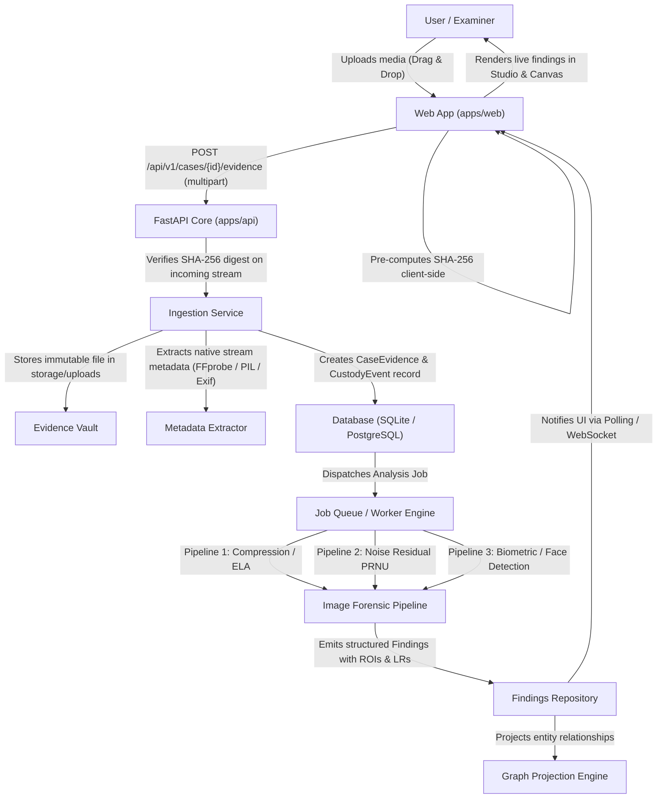

# SPECTRIX Architecture Overview

## 1. Architectural Principles

1. **Evidence Integrity Above Convenience**: Evidence assets are registered immutably with SHA-256 digests. Raw original files are never overwritten or modified.
2. **Local-First & Privacy Preserving**: Forensic investigations often involve sensitive material. All core ingestion, hash calculations, and baseline forensic pipelines run locally without external cloud dependencies. External AI providers are strictly opt-in.
3. **Modular Monolith**: Clean separation of domain modules (Cases, Evidence, Findings, Jobs, Graph, Copilot) in a unified backend structure to simplify local execution and testing.
4. **Authoritative Relational Truth with Graph Projections**:
   - PostgreSQL (or SQLite locally) is the authoritative system of record for all entities, custody logs, and structured findings.
   - Graph relationships (edges, hops, entity linkages) are projected into Neo4j (when available) or served via relational queries.
5. **Decoupled Asynchronous Processing**:
   - Forensic analyses (FFmpeg demuxing, ELA computation, PRNU extraction, deepfake neural inference) are executed as background jobs with explicit status tracking (`queued`, `processing`, `completed`, `failed`).

---

## 2. Monorepo Directory Organization

```
SPECTRIX/
├── apps/
│   ├── web/                    # React 19 + TypeScript + Vite + Tailwind CSS
│   │   ├── src/
│   │   │   ├── components/     # Reusable UI & forensic tools
│   │   │   ├── workspaces/     # Canvas, Image Studio, Video Studio, Audio Studio
│   │   │   ├── services/       # Typed API client
│   │   │   ├── types/          # Shared TypeScript contracts
│   │   │   └── hooks/          # Audio, video, canvas interaction hooks
│   │   ├── package.json
│   │   └── vite.config.ts
│   │
│   └── api/                    # Python 3.12+ FastAPI Application
│       ├── spectrix/
│       │   ├── core/           # Config, database engine, security
│       │   ├── models/         # SQLAlchemy 2.0 ORM models
│       │   ├── schemas/        # Pydantic v2 domain schemas & contracts
│       │   ├── routers/        # Versioned API routes (/api/v1/...)
│       │   ├── services/       # Ingestion, hashing, analysis orchestration
│       │   └── pipelines/      # Image, video, audio forensic analysis engines
│       ├── tests/              # Pytest unit & integration suites
│       ├── requirements.txt
│       └── main.py
│
├── shared/
│   ├── contracts/              # Shared JSON schemas & API types
│   └── fixtures/               # Test evidence fixtures & ground truth
│
├── storage/                    # Local storage (Git-ignored)
│   ├── uploads/                # Immutable original evidence
│   ├── derivatives/            # Thumbnails, extracted audio, ELA heatmaps
│   └── temp/                   # Temporary processing buffers
│
├── references/
│   └── stitch/                 # Original Stitch design exports
│
├── docs/                       # Architecture, Design System, API docs
├── docker-compose.yml          # Container configuration
├── .env.example
├── .gitignore
└── README.md
```

---

## 3. Data Flow & Forensic Pipeline Lifecycle



---

## 4. Hardware Awareness & Execution Modes

SPECTRIX is calibrated for modern developer workstations (e.g. AMD Ryzen + NVIDIA RTX 4050/3060 6GB VRAM, 16GB RAM):
- **CPU Fallback**: Classical forensic techniques (SHA-256, EXIF parsing, ELA, basic noise residual, Web Audio FFT) run at high speed on CPU with zero GPU dependencies.
- **Selective GPU Acceleration**: Optional PyTorch / ONNX Runtime pipelines load models on demand into VRAM and unload when inactive to prevent out-of-memory errors.
- **Sampling & Frame Limits**: Long video files default to scene-based or keyframe sampling rather than processing all 5,000+ frames at once.

